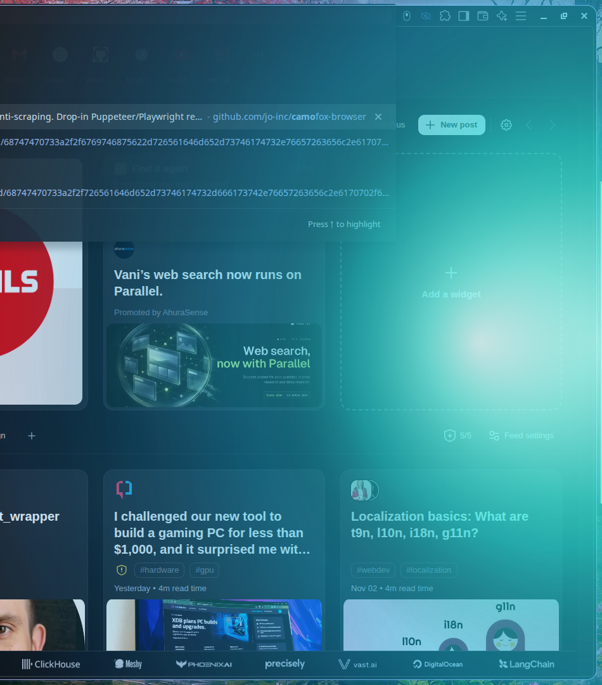
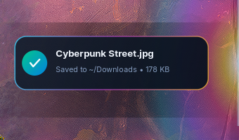

# 💧 drooop-linux

> **Spatial Cross-Device Transfer & Continuity System for Linux (Wayland / Hyprland)**  
> Inspired by [Tornike Gomareli's **drooop**](https://x.com/gomarelit/status/1782062590483861869).

---



## ✨ What is drooop-linux?

**drooop-linux** brings Apple-like spatial drag-and-drop file transfers, dynamic bezel aura effects, and real-time video continuity to native Linux desktops running Wayland/Hyprland. 

By running a hardware-accelerated **GTK4 Layer Shell** surface over your compositor and an ultra-low latency WebSocket signaling engine, files and videos fluidly transfer between your phone and laptop screen bezels as if your monitors are physically adjacent.

---

## 🌟 Key Features

1. **Spatial Edge Meniscus & Fluid Bloom (`overlay.py`)**:
   - Built on `gtk4-layer-shell` and Cairo.
   - Anchored to your right screen bezel (`eDP-1`) with `OVERLAY` layer priority.
   - Full mouse click-through (`cairo.Region()`) so your normal desktop workflow is 100% uninterrupted.
   - **Multi-Harmonic Living Fluid Wave**: Dynamic surface tension wobble that breathes and flexes with your finger gestures.
   - **Pressure-Sensitive Ambient Sink**: Sweeps up to 900px deep into your desktop wallpaper as push depth or touch pressure intensifies.
   - **4 Ambient Themes**: Liquid Seafoam, Aurora Borealis, Cyberpunk Neon Plasma, and Molten Solar Flare.
   - **Zero Idle CPU**: Automatically drops to 0.0% CPU when released, with a clean clearing pass that wipes the surface to 100% transparency.

2. **Real-Time Video Continuity Handoff**:
   - Start watching a video on your phone, then fling it toward the left bezel.
   - A chromatic portal shockwave detonates across your laptop display.
   - Automatically resumes playback instantly in `mpv` at the exact second (`mpv --start=<timestamp>`).

3. **Spatial File & Photo Transfers**:
   - Drag any photo or custom file off your phone's screen edge to beam it to your laptop.
   - An animated frosted glass card bounces onto your desktop showing file name, size, and drop status.
   - Saved automatically into `~/Downloads`.
   - Native desktop notification via `notify-send` / `org.freedesktop.Notifications`.

4. **LocalSend-Compatible Clipboard & Two-Way Push**:
   - Push clipboard text directly between phone and laptop via `wl-copy`.
   - Drop zone on your desktop to send files back to your mobile device.

5. **Standalone Native Desktop Hub (`hub.py`)**:
   - Frosted GTK4 desktop control panel with server status, IP display, QR code for instant phone pairing, service toggles, and live theme picker.

---

## 📸 Visual Showcase

| Wide Fluid Bezel Bloom | Frosted Drop Confirmation Card |
| :---: | :---: |
|  |  |

---

## 🛠️ Architecture

```
                                      [ Mobile Phone (PWA) ]
                                                │
                          WebSocket Telemetry   │  HTTP Multipart
                           (x, y, proximity,    │  (Payloads / Photos)
                                pressure)       │
                                                ▼
                                    ┌───────────────────────┐
                                    │      server.py        │
                                    │ (FastAPI & Uvicorn)   │
                                    │    Port 0.0.0.0:8080  │
                                    └───────────┬───────────┘
                                                │
                       ┌────────────────────────┼────────────────────────┐
                       │ Local WebSocket        │ OS Subprocess          │ File IO
                       ▼                        ▼                        ▼
           ┌───────────────────────┐  ┌───────────────────┐    ┌─────────────────┐
           │      overlay.py       │  │  mpv / wl-copy    │    │   ~/Downloads   │
           │ (GTK4 Layer Shell +   │  │ (Video continuity │    │                 │
           │   Cairo Meniscus)     │  │   & clipboard)    │    └─────────────────┘
           └───────────────────────┘  └───────────────────┘
```

---

## 🚀 Quick Start

### 1. Requirements

- **Linux Compositor**: Wayland (Hyprland, Sway, River, or any `wlroots`/`ext-layer-shell` compositor).
- **Dependencies**:
  ```bash
  # Arch Linux
  sudo pacman -S gtk4 gtk4-layer-shell python-cairo python-gobject mpv wl-clipboard
  ```

### 2. Run Directly

Clone the repository and run the startup script:

```bash
git clone https://github.com/ziuus/drooop-linux.git
cd drooop-linux

# Start daemon and overlay
./run.sh
```

Then open the mobile web app on your phone by navigating to:
```
http://<your-laptop-ip>:8080
```
*(Or launch `python3 hub.py` to scan the on-screen pairing QR code).*

---

## 📦 Installation & Systemd Service

### Automated Installer

Run the included install script:

```bash
chmod +x install.sh
./install.sh
```

This installs:
- Global CLI binary `drooop` in `~/.local/bin/drooop`
- Desktop Application Launcher entry (`drooop.desktop`) with high-res icon
- Background systemd user service (`~/.config/systemd/user/drooop.service`)

### Systemd User Service

Enable and start drooop on boot:

```bash
systemctl --user enable --now drooop.service
```

Check service status or logs:
```bash
systemctl --user status drooop.service
journalctl --user -u drooop.service -f
```

---

## ⌨️ CLI Usage

```bash
# Start background daemon & overlay
drooop start

# Open Native GTK4 Control Hub & QR Code
drooop gui

# Check daemon status
drooop status

# Share a file from laptop terminal to phone
drooop share /path/to/picture.png

# Stop all running services
drooop stop
```

---

## 🎨 Compositor Rules (Hyprland)

In your `hyprland.conf`, you can optionally fine-tune layer blur:

```ini
# Optional: keep overlay crisp and disable compositor background blur over the layer
layerrule = noblur, drooop-aurora
```

---

## 📡 WebSocket Signaling Protocol

The daemon exposes a WebSocket endpoint at `ws://<host>:8080/ws`.

| Packet Type | Fields | Description |
| :--- | :--- | :--- |
| `drag_move` | `y` (0.0–1.0), `proximity` (0.0–1.0), `pressure` (0.0–1.0) | Streams continuous touch coordinates and push depth |
| `drag_edge_enter` | `y` (0.0–1.0) | Emitted when touch enters bezel trigger zone |
| `drag_edge_leave` | none | Emitted on touch release; triggers immediate transparent fade |
| `drag_drop` | `filename`, `size`, `y` | Triggers frosted glass drop card animation |
| `video_resume` | `url`, `time` (seconds), `y` | Triggers shockwave portal and resumes playback in `mpv` |
| `set_effect` | `theme`: `"liquid"` \| `"aurora"` \| `"plasma"` \| `"solar"` | Switches active ambient shader theme |

---

## 📄 License

MIT License. Crafted with ❤️ for Linux and Wayland enthusiasts.
