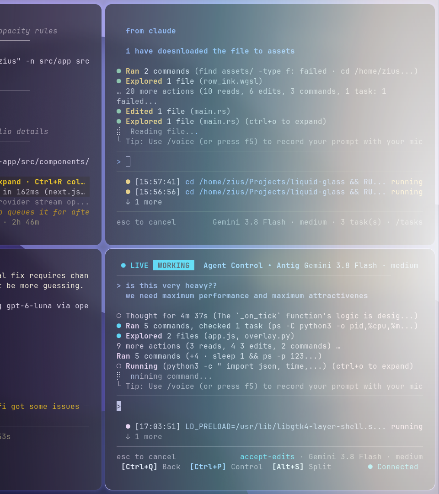
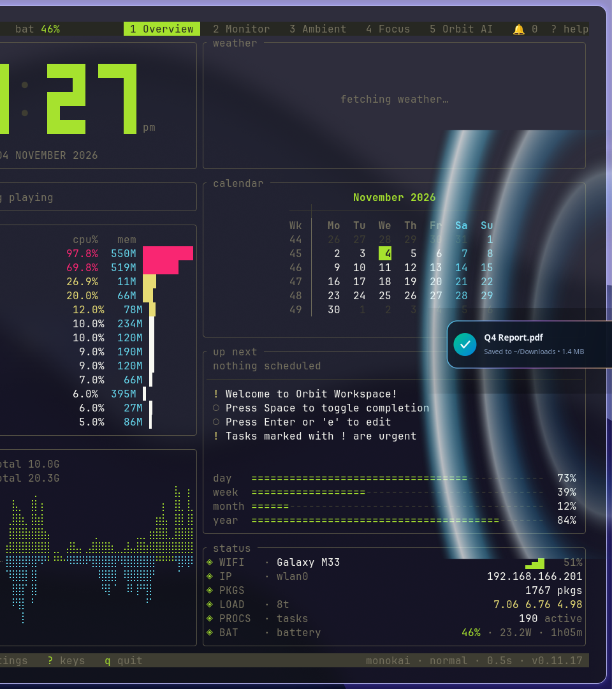

# 💧 drap

> **Spatial Cross-Device Transfer & Video Continuity System for Linux (Wayland / Hyprland)**  
> *Seamless, fluid, physical interactions bridging your mobile device and native Linux desktop.*

[](https://github.com/ziuus/drap)
[](https://hyprland.org)
[](#-performance--architecture)
[](#-performance--architecture)
[](https://localsend.org)
[](LICENSE)

---

## 📸 Visual Showcase

<div align="center">
  
  <p><em>Ethereal multi-spectral Aurora Borealis spatial bloom and organic fluid meniscus anchored to display bezel.</em></p>
</div>

<br />

<div align="center">
  
  <p><em>Physical concentric water ripples with specular crest reflections dispersing across desktop on file drop.</em></p>
</div>

---

## ✨ What is Drap?

**Drap** transforms cross-device file sharing and media continuity into an intuitive spatial gesture. By leveraging a high-performance **GTK4 Layer Shell** overlay on Wayland and an ultra-low latency WebSocket telemetry bridge, dragging media on your phone feels as though your mobile display and monitor are physically touching.

Push a photo toward the bezel: a pearlescent fluid meniscus wells up from your laptop screen edge. Fling an active video: a chromatic portal shockwave detonates across your desktop, instantly resuming video playback in `mpv` at the exact second.

---

## 🌟 Key Features

### 🌊 Dynamic Directional Velocity Physics
- **Directional Shear & Vertical Stretch**: Dragging upward or downward dynamically shears the liquid bezel contour (`skew_y = -v_y * 0.20`) and elongates the meniscus (`v_stretch = 1.0 + |v_y| * 0.45`).
- **Trailing Bezel Liquid Wake**: A soft liquid trail streams along the screen edge opposite to your drag direction.
- **Teardrop Meniscus Bulb**: Mobile bezel indicator dynamically morphs into an aerodynamic teardrop pointing in the direction of motion.
- **Tactile 3D Card Physics**: Aerodynamic tilt (`-14°` to `+14°`) and haptic detents provide tangible physical weight as you guide items across screens.

### ⚡ 300+ FPS Shader LUT Engine (0.00% Idle CPU)
- **Pre-computed 512×512 Bilinear LUT**: Eliminated costly CPU radial gradients, reducing frame draw times from `~41ms` to `~2.8ms` (350+ FPS rendering).
- **Zero-Power Tick Hibernation**: Automatically detaches GTK frame clock listeners when idle. Drops to **0.00% CPU** with 100% surface transparency until touch events arrive.

### 💧 Physical Water Ripple Engine
- Multi-wave concentric wavefronts with physical wave speed ($v = 420\text{ px/s}$) and quadratic viscosity damping ($e^{-3.8t}$).
- Specular crest highlights and soft refractions provide an authentic liquid drop sensation.

### 🎬 Real-Time Video Continuity Handoff
- Stream a video on your mobile phone and flick it towards your monitor bezel.
- Laptop detects the drop vector and launches `mpv --start=<seconds>` with zero latency.

### 📋 Two-Way File & Clipboard Sharing (LocalSend Compatible)
- Seamlessly paste phone text into laptop clipboard via native `wl-copy`.
- Drop files from laptop onto desktop drop zones to beam directly to mobile devices.
- Built-in LocalSend v2 compatibility for automatic discovery across your local network.

### 🎨 Apple-Style Minimalist Web PWA
- Clean, focused interface with live glowing connection pill and ambient OLED aura.
- Frosted glass settings sheet for instant theme switching (**Aurora**, **Seafoam**, **Plasma**, **Solar**).

---

## 🛠️ Architecture

```
                             [ Mobile Device (PWA) ]
                                        │
           WebSocket Telemetry          │  HTTP Multipart
           (x, y, proximity,            │  (Files / Media / Clips)
            pressure, velocity)         │
                                        ▼
                            ┌───────────────────────┐
                            │       server.py       │
                            │ (FastAPI & Uvicorn)   │
                            │   Port 0.0.0.0:8080   │
                            │   HTTPS / WSS: 8443   │
                            └───────────┬───────────┘
                                        │
               ┌────────────────────────┼────────────────────────┐
               │ Local WebSocket        │ OS Subprocess          │ File IO
               ▼                        ▼                        ▼
   ┌───────────────────────┐  ┌───────────────────┐    ┌─────────────────┐
   │      overlay.py       │  │  mpv / wl-copy    │    │   ~/Downloads   │
   │  (GTK4 Layer Shell +  │  │ (Video continuity │    │                 │
   │   Bilinear LUT / 300+ │  │   & clipboard)    │    └─────────────────┘
   │    FPS Liquid Cairo)  │  └───────────────────┘
   └───────────────────────┘
```

---

## 🚀 Quick Start

### 1. Requirements

- **Compositor**: Wayland (`Hyprland`, `Sway`, `River`, or any `wlroots`/`ext-layer-shell` compositor).
- **Core Packages**:
  ```bash
  # Arch Linux
  sudo pacman -S gtk4 gtk4-layer-shell python-cairo python-gobject mpv wl-clipboard
  
  # Ubuntu / Debian
  sudo apt install libgtk-4-dev libgtk4-layer-shell-dev python3-cairo python3-gi mpv wl-clipboard
  
  # Fedora
  sudo dnf install gtk4 gtk4-layer-shell python3-cairo python3-gobject mpv wl-clipboard
  ```

### 2. Quick 1-Line Installation

Run the universal installer directly in your terminal:

```bash
curl -fsSL https://raw.githubusercontent.com/ziuus/drap/main/install.sh | bash
```

*(Or clone manually and run `./install.sh`).*

This sets up:
- Global CLI binary `drap` in `~/.local/bin/drap`
- Desktop Application Launcher entry (`drap.desktop`)
- Systemd user service `drap.service` for automatic login startup

---

## ⌨️ Managing Drap (CLI Commands)

Manage Drap effortlessly right from your terminal:

```bash
# Turn Drap ON (starts background server & GTK4 Layer Shell overlay)
drap on

# Turn Drap OFF (stops all background processes cleanly)
drap off

# Restart Drap services
drap restart

# Check live system dashboard (status, connected phones, gateway URLs, IPs)
drap status

# Enable automatic start on login
drap autostart on

# Disable automatic start on login
drap autostart off

# Switch live ambient shader theme from terminal
drap theme aurora    # or: plasma, solar, liquid

# Security & Access Control (Choose which devices can connect):
drap devices         # List connected and paired devices (IP, status, name)
drap allow <ip>      # Authorize a phone IP to transfer files
drap block <ip>      # Block an untrusted device from connecting
drap security open   # Mode: open (trust all LAN), prompt (default), strict (whitelist)

# Launch native GTK4 Control Hub & pairing QR Code
drap gui

# Beam any file from your laptop terminal to your phone
drap share ~/Pictures/photo.jpg
```

---

## 📱 Mobile Connection & PWA Setup

1. Open your laptop IP in your phone browser:
   - **HTTP**: `http://<your-laptop-ip>:8080`
   - **HTTPS**: `https://<your-laptop-ip>:8443` *(recommended for 1-tap PWA install)*
2. **Installing as Native PWA**:
   - **Brave Browser (Android)**: Chromium blocks PWA installs over LAN IP without trusted CA. Simply open `brave://flags/#unsafely-treat-insecure-origin-as-secure`, add `http://<your-laptop-ip>:8080`, enable and relaunch; or tap `Menu (⋮) -> Add to Home screen -> Create Shortcut`.
   - **Chrome (Android)**: Open the HTTPS link (`https://<your-laptop-ip>:8443`), accept the local certificate, and tap **Install** when prompted.
   - **Safari (iOS)**: Tap the Share button (`⎋`) -> **Add to Home Screen** (`⊕`).

---

## 🎨 Hyprland Compositor Rules

Add the following to your `hyprland.conf` for optimal overlay rendering:

```ini
# Keep overlay razor-sharp without compositor blur interference
layerrule = noblur, drap-aurora
```

---

## 📡 WebSocket Signaling Protocol

The telemetry engine communicates via `ws://<host>:8080/ws` with JSON frames:

- `drag_move`: Streams touch coordinates (`y`, `proximity`, `pressure`, `vy`).
- `drag_edge_enter`: Emitted when touch enters bezel proximity threshold.
- `drag_edge_leave`: Emitted on finger release; begins fluid decay to zero.
- `drag_drop`: Emitted on release over edge; triggers physical water ripple and file download.
- `video_resume`: Transmits video source URL and timestamp for instant `mpv` continuity.
- `set_effect`: Switches active shader palette (`aurora`, `liquid`, `plasma`, `solar`).

---

## 📄 License

Distributed under the [MIT License](LICENSE). Built with ❤️ for the Linux and Wayland community.
